# Tenant Compass

*Boîte à outils pour le portail Microsoft Intune.* · [English version](README.en.md)

Tenant Guard, As-Built en un clic, Setting Inspector, Settings Explainer, Assignment Lens, Assignment Search, Change Snapshot, Set Tenant Language, Raccourci PIM (avec les raccourcis Entra ID, Intune et Defender), Policy Import, Bulk Assignment et Scope Tags Clean up réunis dans une seule extension Chrome / Edge (Manifest V3). Chaque fonction s'active ou se désactive depuis le menu de l'extension. Aucune application à inscrire dans le tenant : l'extension réutilise la session Microsoft Graph du portail.

Architecture détaillée (scripts, flux, sécurité, stockage) : [ARCHITECTURE.md](ARCHITECTURE.md).

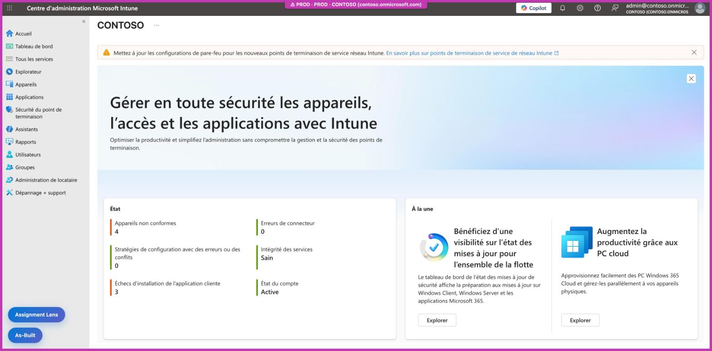

> **Deux réglages de langue distincts.** La langue du **portail Intune** (Paramètres > Langue + région, ou les boutons 🌐 de Set Tenant Language) et celle de **l'extension** (boutons FR / EN du menu) se règlent séparément : changer l'une ne change pas l'autre. Les captures de ce document sont prises avec le portail **et** l'extension en français ; la [version anglaise](README.en.md) les montre tous deux en anglais.

> **À propos des captures.** Elles sont prises dans un vrai tenant de test. Le nom du tenant, le domaine, le compte et les balises d'étendue sont anonymisés (`contoso.onmicrosoft.com`, « Paris ») avant chaque capture, directement dans la page. Les pages du menu de l'extension ne peuvent pas être capturées par l'outil d'automatisation : elles sont rendues avec le code réel de `popup.html`, dans une page locale, avec des données fictives (Contoso, Fabrikam, Northwind).

## Sommaire

- [Fonctions](#fonctions)
- [Installation](#installation)
- [Données et confidentialité](#données-et-confidentialité)
- [Menu](#menu)
- [Tenant Guard](#tenant-guard)
- [As-Built](#as-built-panneau-dans-le-portail)
- [Assignment Lens](#assignment-lens)
- [Assignment Search](#assignment-search)
- [Setting Inspector](#setting-inspector)
- [Settings Explainer](#settings-explainer)
- [OpenIntuneBaseline](#openintunebaseline)
- [Change Snapshot](#change-snapshot)
- [Set Tenant Language](#set-tenant-language)
- [Raccourci PIM](#raccourci-pim)
- [Policy Import](#policy-import)
- [Bulk Assignment](#bulk-assignment)
- [Scope Tags Clean up](#scope-tags-clean-up)
- [Déplacement](#déplacement)
- [Fonctionnement](#fonctionnement)
- [Limites](#limites)
- [Tests](#tests)

## Fonctions

| Fonction | Ce qu'elle fait | Où |
|---|---|---|
| Tenant Guard | Bandeau et cadre de couleur du tenant actif ; confirmation avant Enregistrer, Supprimer, Attribuer, Créer, Wipe, Retire dans un tenant PROD | Consoles d'administration Intune, Entra, Azure, Defender, M365, Purview, Exchange, Teams, SharePoint (voir [Consoles prises en charge](#consoles-prises-en-charge)) |
| As-Built en un clic | Export des stratégies choisies en Markdown, Word, HTML et JSON, scripts compris. Intune et Entra (accès conditionnel, authentification, mobilité) | Bouton en bas à gauche (Intune, Entra, Azure) |
| Setting Inspector | Carte au survol d'un paramètre du catalogue, section détails : identifiant, OMA-URI / clé, applicabilité, licence, GPO équivalente, liens Learn | Carte au bord droit, au survol d'un paramètre |
| Settings Explainer | Même carte, section explication : texte rédigé, page Learn lue en direct, valeurs, valeur par défaut. Activable seule | Même carte |
| OpenIntuneBaseline | Même carte, section OIB : valeur configurée par la baseline communautaire OpenIntuneBaseline et stratégie concernée. Activable seule | Même carte |
| Assignment Lens | Groupes inclus / exclus, membres, filtres, chevauchements de la stratégie affichée | Bouton au-dessus d'As-Built |
| Assignment Search | Stratégies et applications affectées à un groupe, un utilisateur ou un appareil (groupes imbriqués, exclusions, filtres), ou sans affectation ; export JSON. Reprend l'utilisateur, l'appareil ou le groupe ouvert dans le portail | Bouton au-dessus d'Assignment Lens (Intune) |
| Change Snapshot | Journal local des modifications : différence avant / après, auteur, n° de ticket, export JSON / CSV | Fenêtre en bas à droite après un enregistrement ; journal depuis le menu |
| Set Tenant Language | Bascule la console entre deux langues prédéfinies, en 1 clic | Boutons 🌐 du menu ; Intune, Azure, Entra, Defender, Purview |
| Raccourci PIM | Ouvre PIM > Mes rôles (affectations éligibles ou actives), Entra ID, Intune ou Defender sur le tenant de l'onglet actif, en 1 clic | Boutons 🔑 PIM éligible, 🔑 PIM actif, 🪪 Entra ID, 💻 Intune et 🛡️ Defender du menu |
| Policy Import | Crée des stratégies à partir d'exports JSON As-Built, avec affectation (groupe, tous les utilisateurs, tous les appareils) et scope tags en option. **Écrit dans le tenant : désactivée par défaut** | Bouton Import, au-dessus d'Assignment Search (Intune) |
| Bulk Assignment | Ajoute à plusieurs stratégies une affectation (groupe, tous les utilisateurs, tous les appareils), un filtre et des scope tags. **Écrit dans le tenant : désactivée par défaut** | Bouton Bulk Assign, au-dessus d'Import (Intune) |
| Scope Tags Clean up | Retire un scope tag choisi dans une liste (Default ou un autre) des stratégies et applications qui en gardent au moins un autre. **Écrit dans le tenant : désactivée par défaut** | Bouton Scope Tags, au-dessus de Bulk Assign (Intune) |

## Installation

1. Ouvrir `edge://extensions` (ou `chrome://extensions`) et activer le **mode développeur**.
2. Cliquer sur **Charger l'extension décompressée** et choisir le dossier `tenant-compass/`.
3. Désactiver les extensions séparées Tenant Guard, As-Built, Setting Inspector et Assignment Lens si elles sont chargées, sinon tout s'affiche en double.
4. Après une mise à jour du dossier : bouton **↻** de l'extension dans `edge://extensions`, puis recharger l'onglet du portail.

## Données et confidentialité

**Aucune donnée n'est envoyée à un tiers, ni à l'auteur de l'extension.** Pas de télémétrie, pas de statistiques d'usage, pas de serveur propre. Tout ce que l'extension lit, calcule ou enregistre reste dans le navigateur. Les seuls échanges réseau partent vers des services Microsoft que le portail utilise déjà :

| Fonction | Échange réseau | Contenu |
|---|---|---|
| As-Built, Assignment Lens, Assignment Search | Lectures (`GET`) sur `graph.microsoft.com`, avec la session du portail | Les stratégies, applications, groupes, utilisateurs et appareils affichés ou recherchés, comme le fait le portail |
| Policy Import, si vous l'activez | Lecture des noms existants (`GET`) et création (`POST`) sur `graph.microsoft.com`, avec la session du portail | Les stratégies des fichiers que vous choisissez et confirmez, et si vous le demandez leur affectation et leurs scope tags |
| Bulk Assignment, si vous l'activez | Lectures (`GET`) des stratégies, affectations, groupes, filtres et scope tags, puis `POST …/assign` et `PATCH` (scope tags) sur `graph.microsoft.com`, avec la session du portail | Les stratégies que vous cochez, avec leurs affectations existantes |
| Scope Tags Clean up, si vous l'activez | Lectures (`GET`) des stratégies, applications et scope tags, puis `PATCH` sur `graph.microsoft.com`, avec la session du portail | Les scope tags des objets que vous cochez |
| Settings Explainer | Lecture sans cookie de pages publiques `learn.microsoft.com/…/windows/client-management/mdm/` | Aucune donnée du tenant : seulement le nom de la page de documentation demandée |
| Tenant Guard, Setting Inspector, OpenIntuneBaseline, Change Snapshot, Set Tenant Language, Raccourci PIM | Aucun | Ils observent la page et les réponses que le portail reçoit déjà |

- **Jeton** : le jeton du portail n'est jamais enregistré, journalisé ni transmis au service worker. Change Snapshot n'en garde que l'auteur (`upn`) et l'identifiant du tenant (`tid`).
- **Stockage local** : réglages, tenants référencés et couleurs dans `chrome.storage.sync` ; définitions captées, cache des pages Learn et journal Change Snapshot dans `chrome.storage.local` ; positions des panneaux dans le `localStorage` du portail. Le détail est dans [ARCHITECTURE.md](ARCHITECTURE.md), section 8.
- **Synchronisation du navigateur** : `chrome.storage.sync` suit la synchronisation du profil Edge ou Chrome. Si elle est activée, les réglages et les tenants référencés sont copiés sur vos autres appareils par le navigateur lui-même, comme vos favoris. Le journal Change Snapshot et les définitions captées restent sur l'appareil.

## Menu

Clic sur l'icône de l'extension. À gauche, la colonne **🌐 FR / 🌐 EN** bascule la console entre les deux langues prédéfinies ([Set Tenant Language](#set-tenant-language)) ; à droite, les pastilles des fonctions actives (description au survol, 📋 ouvre le journal de Change Snapshot). Dessous, les boutons violets **🔑 PIM éligible** et **🔑 PIM actif**, puis la ligne **🪪 Entra ID**, **💻 Intune** et **🛡️ Defender** ([Raccourci PIM](#raccourci-pim)). Si Tenant Guard est actif, le tenant détecté dans l'onglet et la liste des tenants référencés restent modifiables directement.

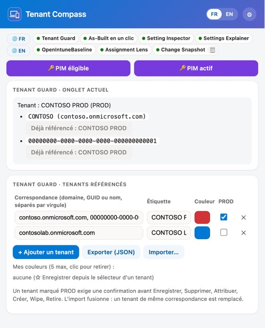

| Paramètres (⚙), fonctions | Paramètres (⚙), suite |
|---|---|
| 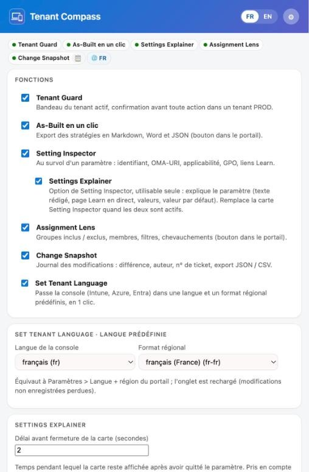 | 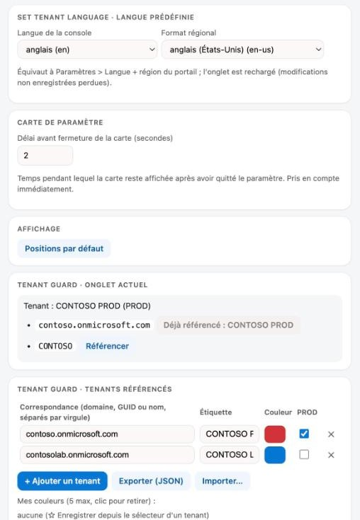 |

*Menu rendu avec le code réel de `popup.html` et des tenants fictifs (Contoso) : la page de l'extension ne peut pas être capturée par l'outil d'automatisation.*

- **FR / EN** (en-tête) : langue de l'extension, Français (FR) ou English (US) : menu, panneaux et cartes dans le portail, boîtes de confirmation, journal, intitulés des exports As-Built. Mémorisée dans le profil du navigateur ; par défaut, la langue du navigateur. Dans le portail, la langue s'applique au rechargement de l'onglet.
- **Bouton bleu « Recharger l'onglet du portail pour appliquer (fonctions et langue) ↻ »** : apparaît après une activation, une désactivation ou un changement de langue.
- **📋** (dans la pastille Change Snapshot) : ouvre le journal des modifications.
- **⚙ Paramètres** (s'ouvrent sous les pastilles) :
  - **Affichage** : **Positions par défaut** replace les boutons et panneaux en bas à gauche.
  - **Fonctions** : une case par fonction, avec sa description. Une fonction décochée n'injecte plus aucun script. **Settings Explainer** et **OpenIntuneBaseline** apparaissent en retrait sous Setting Inspector : ce sont les trois sections de la même carte de paramètre, chacune activable seule, sans lien entre elles.
  - **Set Tenant Language · langues prédéfinies** : Langue 1 et Langue 2 (langue de la console et format régional), appliquées par les deux boutons 🌐 de la colonne de gauche.
  - **Carte de paramètre** : délai avant fermeture de la carte (Setting Inspector, Settings Explainer, OpenIntuneBaseline), en secondes (2 par défaut, de 0 à 60), pris en compte sans recharger le portail.
  - **Change Snapshot** : demande de ticket sur les tenants PROD / non-prod, suppression automatique des anciennes entrées et durée de conservation (voir [Change Snapshot](#change-snapshot)).
- **Tenant Guard · tenants référencés** (vue principale) : correspondance, étiquette, couleur, PROD.
  - **Exporter (JSON)** : télécharge `tenant-guard-AAAA-MM-JJ.json` (`{ rules: [{ match, label, color, prod }], customColors: ["#rrggbb"] }`).
  - **Couleur** : voir [Tenant Guard](#tenant-guard).
  - **Importer…** : fusionne un fichier exporté ; un tenant de même correspondance est remplacé (étiquette et couleur comprises), « Mes couleurs » sont fusionnées (5 au maximum). Depuis le menu, le bouton ouvre la page d'options en onglet (le menu se ferme quand le sélecteur de fichier s'ouvre).

Ajouter une langue : un dictionnaire dans `shared/i18n.js` (menu) et dans chaque `<fonction>/i18n.js` (mêmes clés), un fichier `shared/lang/<code>.js`, le code dans `LANGS` de `background.js` et un bouton `data-lang` dans `popup.html`.

## Tenant Guard

Pastille en haut de page (étiquette du tenant référencé) et cadre de la couleur choisie autour du portail (voir la [vue d'ensemble](#tenant-compass)). Dans un tenant marqué PROD, les actions sensibles (Enregistrer, Supprimer, Attribuer, Créer, Wipe, Retire) sont bloquées tant qu'elles ne sont pas confirmées. **Annuler** a le focus par défaut, Échap annule.

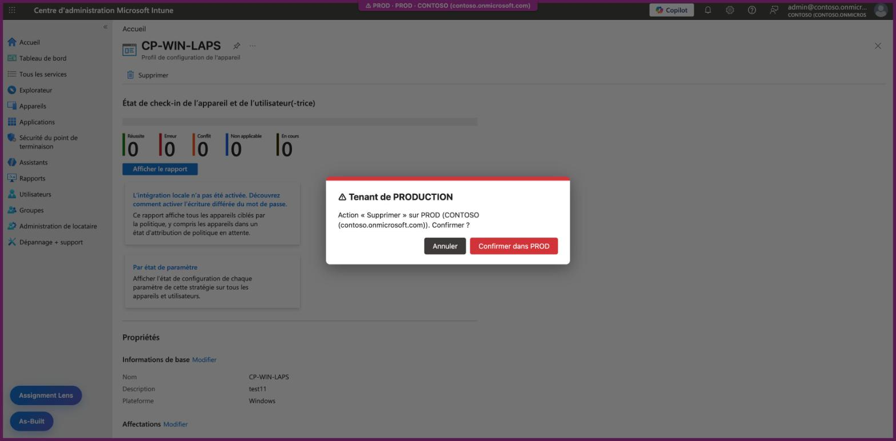

**Couleur d'un tenant** (menu, colonne Couleur) : ligne 1, les 5 couleurs prédéfinies ; ligne 2, « Mes couleurs » (5 au maximum) ; dessous, curseurs teinte / luminosité et code `#RRGGBB` avec aperçu (clic sur l'aperçu ou Entrée pour appliquer). **☆ Enregistrer** ajoute la couleur courante à « Mes couleurs ». **Autre…** ouvre le sélecteur natif dans la page d'options (le sélecteur natif fermerait le menu).

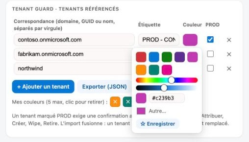

### Consoles prises en charge

Consoles d'administration uniquement : rien n'est injecté dans les pages utilisateur (Outlook, Teams, sites SharePoint, Power BI…). Testé le 2026-10-04 (détection du tenant, pastille, cadre).

| Console | Adresse | Testé |
|---|---|---|
| Intune | `intune.microsoft.com` (et `endpoint.microsoft.com`, redirigé) | ✅ |
| Entra | `entra.microsoft.com` (et `aad.portal.azure.com`, redirigé) | ✅ |
| Azure | `portal.azure.com` | ✅ |
| Defender | `security.microsoft.com` | ✅ |
| Centre d'administration Microsoft 365 | `admin.cloud.microsoft` (et `admin.microsoft.com`, redirigé) | ✅ |
| Exchange | `admin.cloud.microsoft/exchange` (et `admin.exchange.microsoft.com`) | ✅ |
| Purview | `purview.microsoft.com` (et `compliance.microsoft.com`, redirigé) | ✅ |
| Teams | `admin.teams.microsoft.com` | ✅ |
| SharePoint | `<tenant>-admin.sharepoint.com` | ✅ |

Non pris en charge : Power Platform, Power BI / Fabric.

Détection du tenant, par ordre de priorité : URL (`tid=`, `tenantId=`, `ctid=`, `#@domaine`), nom de l'annuaire affiché dans l'en-tête, clés du cache MSAL de la page (seulement si un seul tenant y figure). Pour référencer un tenant : menu, *Onglet actuel*, bouton **Référencer** à côté de l'identifiant détecté. Un tenant référencé par son nom (ex. `contoso.onmicrosoft.com`) apprend son ID de tenant à la première visite d'Intune, Entra ou Azure : il est ensuite reconnu aussi dans les consoles qui n'exposent que l'ID (Defender, Centre d'administration Microsoft 365).

## As-Built (panneau dans le portail)

Bouton **As-Built** en bas à gauche. Le panneau liste les stratégies et applications du tenant, avec leur type et leur plateforme.

| Panneau | Sélection de stratégies |
|---|---|
|  | 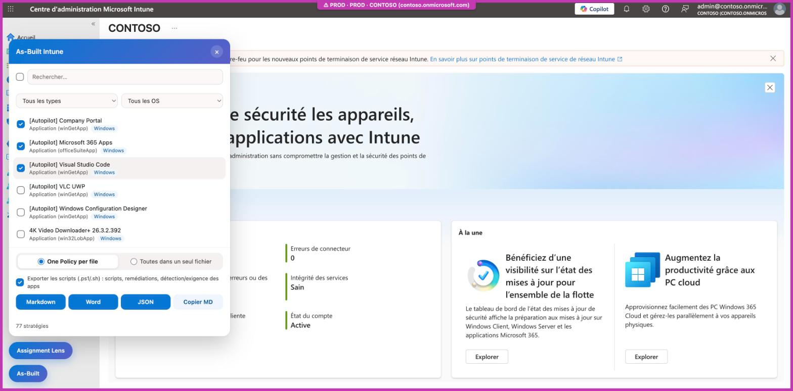 |

- Sources (console Intune) : catalogue de paramètres, profils de configuration, conformité, ADMX, applications, scripts PowerShell, scripts shell macOS, attributs personnalisés macOS, remédiations, profils Autopilot, appareils Autopilot, inscription (page d'état d'inscription ESP, restrictions, Windows Hello...), profils Apple ADE (DEP), profils d'inscription Android Enterprise / AOSP, personnalisation du tenant (profils de marque), rôles Intune (RBAC, avec leurs affectations : membres, étendue, balises), balises d'étendue.
- Filtres : recherche par nom, type, OS. La case en tête de liste coche ou décoche tout ce qui est affiché.
- **Stratégie ouverte** : celle affichée dans le portail est placée en tête de liste, sans être cochée. Les éléments cochés remontent ensuite dans l'ordre où ils ont été cochés ; la liste ne défile pas quand un élément remonte.
- **Appareils Autopilot** : un seul élément pour tout l'inventaire, exporté en plus en CSV (`autopilot-devices-<date>.csv`, séparateur `;`) : numéro de série, fabricant, modèle, group tag, utilisateur, état du profil et de l'inscription. **Le hachage matériel (HWID) n'est pas inclus** : Graph ne le renvoie pas pour un appareil déjà inscrit. Le fichier n'est donc pas réimportable dans Autopilot.
- **Secrets masqués** : jeton d'inscription Android et contenu du QR code, mot de passe de compte Surface Hub, clé de produit. Les images (logos, QR code) ne sont pas exportées.
- **Console Entra** (`entra.microsoft.com`, `portal.azure.com`) : panneau **As-Built Entra**, autre liste : accès conditionnel, emplacements nommés, niveaux d'authentification, méthodes d'authentification (une ligne par méthode), inscription automatique MDM et MAM (mobilité). Le jeton Graph du portail Entra porte `Policy.Read.All`, absent de celui du portail Intune : ces objets ne sont donc listés que depuis Entra ou Azure.
- **Accès conditionnel** : état (activée, désactivée, rapport seul), conditions, contrôles d'octroi et de session ; utilisateurs, groupes et rôles inclus / exclus dans le tableau **Affectations**. Les identifiants sont remplacés par les noms (utilisateurs, groupes, rôles, applications, emplacements) et les mots-clés traduits (« Tous », « Tous les emplacements approuvés »…). Document titré « Dossier d'architecture détaillée – Microsoft Entra », fichier `as-built-entra-<date>`. Lecture seule, avec les droits du compte connecté.

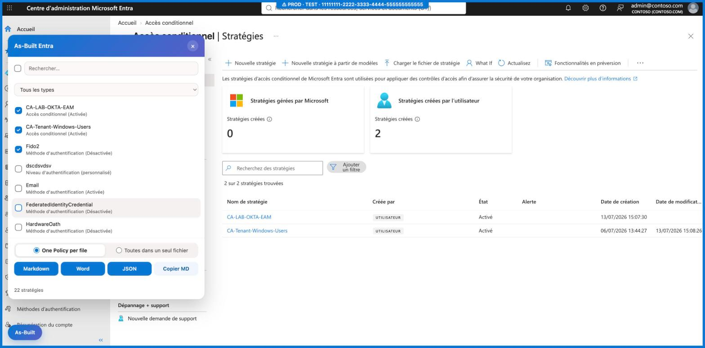

- Mode d'export : **One policy per file** (défaut) ou toutes les stratégies dans un seul fichier. **Copy MD** copie toujours un seul bloc Markdown.
- **Exporter scripts, profils et certificats** (coché par défaut) : télécharge à côté du document, décodés depuis le Base64 de Graph, les scripts (`.ps1`, `.sh`, `.zsh`), attributs personnalisés macOS, remédiations (détection + correction), scripts PowerShell de détection / exigence des applications Win32, scripts de pré / post-installation des applications PKG macOS, profils personnalisés (`.mobileconfig`, fichiers de préférences `.plist`) et certificats de confiance de tous les OS (`.cer`, en DER ou PEM selon le fichier envoyé à Intune). Ces fichiers sont des copies exactes, non masquées : un secret écrit dans un script ou un profil y reste en clair.
- Le fichier `.intunewin` n'est pas exportable : Graph n'expose aucune URL de téléchargement d'un contenu d'application publié (l'URI de stockage n'existe que pendant l'upload, et le contenu est chiffré).

## Assignment Lens

Bouton **Assignment Lens** en bas à gauche, juste au-dessus d'As-Built. Sur une stratégie ou une application ouverte, la carte montre les groupes inclus et exclus, le nombre de membres, les filtres, les cibles virtuelles (Tous les utilisateurs, Tous les appareils) et les chevauchements avec d'autres stratégies de la même famille. ↻ actualise ; × ou un clic sur le titre ferme la carte. La carte se déplace en glissant son en-tête. Un groupe vide (0 membre) s'affiche en rouge : son affectation ou son exclusion n'a aucun effet.

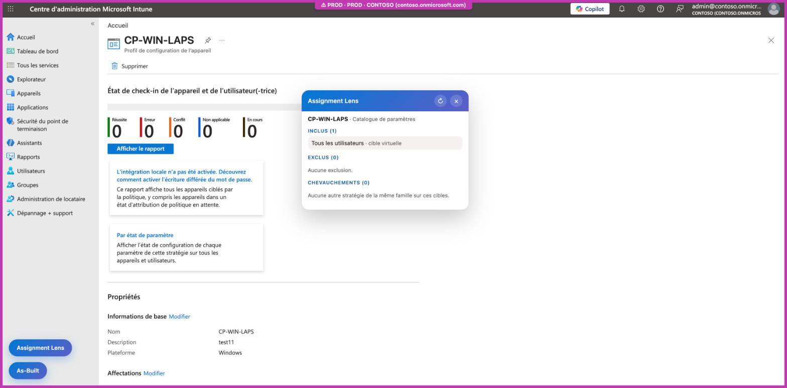

## Assignment Search

Bouton **Assignment Search** en bas à gauche, au-dessus d'Assignment Lens. Il répond à la question inverse : qu'est-ce qui est affecté à cet objet ?

1. Choisir le type d'objet : **Groupe**, **Utilisateur**, **Appareil**, ou **Stratégies et applications sans affectation**.
2. Taper le début du nom du groupe, le début du nom ou de l'UPN de l'utilisateur, une partie du nom de l'appareil, ou coller un ID. La liste déroulante montre d'abord les 100 premiers objets du tenant, puis ceux qui correspondent au texte tapé.
3. Choisir l'objet dans la liste. Le panneau affiche les stratégies et applications qui le ciblent, en deux parties : **Inclus** et **Exclus**.
4. **Exporter (JSON)** télécharge la liste affichée.

- **Filtre par type** : au-dessus des résultats, une liste déroulante ne garde qu'une catégorie, avec son nombre d'objets : **Configuration** (catalogue de paramètres, profils, ADMX, inscription, Autopilot, mises à jour Windows), **Conformité**, **Applications** (applications, configuration et protection d'applications), **Scripts et remédiations**. Le choix est gardé d'un objet à l'autre, et l'export ne contient que la catégorie affichée.
- **Objet ouvert** : sur la page d'un utilisateur, d'un appareil ou d'un groupe du portail, le panneau le choisit et l'analyse dès l'ouverture. Il suit ensuite la navigation : ouvrir un autre utilisateur, appareil ou groupe relance l'analyse.
- **Ce qui compte** :
  - groupe : ses affectations directes et celles de ses groupes parents (quand il est membre d'un autre groupe). Ni « Tous les utilisateurs », ni « Tous les appareils » ;
  - utilisateur : ses groupes, imbrications comprises, et « Tous les utilisateurs » ;
  - appareil : les groupes de son objet Entra ID, imbrications comprises, et « Tous les appareils ». Les affectations de son utilisateur principal ne sont pas listées.
- **Exclusion** : une exclusion qui touche l'objet l'emporte, la stratégie passe dans **Exclus**. Chaque ligne nomme le groupe en cause, le type de déploiement d'une application (Requise, Disponible…) et le filtre d'affectation éventuel. Le filtre n'est pas évalué : l'objet peut être ciblé puis écarté par le filtre.
- **Types lus** : catalogue de paramètres (sécurité du point de terminaison comprise), profils de configuration, conformité, modèles d'administration, applications, configuration et protection d'applications, scripts PowerShell et shell, attributs personnalisés macOS, remédiations, profils Autopilot, inscription (ESP, restrictions), mises à jour Windows (fonctionnalités, qualité, pilotes). Un type que Graph refuse est nommé dans la ligne d'état.
- **Sans affectation** : les objets lus en entier qui n'ont aucune affectation, applications comprises.
- **Lecture seule** : uniquement des `GET` sur Graph, avec la session du portail. Les listes sont lues une fois, à la première recherche ; ↻ les relit.
- **Droits** : en plus de la lecture Intune, le jeton du portail doit pouvoir lire les groupes de l'objet (`transitiveMemberOf` : `GroupMember.Read.All`, `User.Read.All`, `Device.Read.All` ou `Directory.Read.All` selon le type). Sinon, le panneau le signale et ne liste que les affectations directes, « Tous les utilisateurs » ou « Tous les appareils ».
- **Export JSON** : l'objet recherché, ses groupes, puis chaque stratégie avec son type, son OS, son état (inclus ou exclu) et les affectations qui le touchent (groupe, mode, type de déploiement, filtre). Les types non lus figurent dans `coverage`.

- Code : `assignment-search/lib.js` (testé : `node assignment-search/test.js`), `assignment-search/page.js`, `shared/graph-bridge.js`.

## Setting Inspector

Au survol d'un paramètre (catalogue de paramètres, sécurité du point de terminaison, éditeur ou résumé d'une stratégie) : carte contre le bord droit de la fenêtre. Elle réunit trois sections activables séparément dans ⚙ : Setting Inspector (détails, ci-dessous), [Settings Explainer](#settings-explainer) (explication) et [OpenIntuneBaseline](#openintunebaseline). La section Setting Inspector donne l'identifiant de définition, l'OMA-URI (Windows) ou la clé (macOS / iOS), l'applicabilité, la licence et la GPO équivalente (`data/overlay.json`), les liens Microsoft Learn. Le paramètre est reconnu par son identifiant, lu dans le modèle de la page : fonctionne quelle que soit la langue du portail.

Données (`setting-inspector/data/`) :

- `settings.json` : définitions Graph indexées par nom normalisé. La base fournie ne contient que 12 paramètres ; les autres sont capturés au fil de la navigation (réponses Graph du portail, gardées dans `chrome.storage.local`, clé `explainerLive`).
- `overlay.json` : licence et GPO équivalente, que Graph n'expose pas. Fusionné à l'exécution : modifier le fichier puis recharger l'extension.

Régénérer la base complète (Node 18+, sans dépendance, compte avec `DeviceManagementConfiguration.Read.All`) :

```sh
az login
export GRAPH_TOKEN=$(az account get-access-token --resource-type ms-graph --query accessToken -o tsv)
node setting-inspector/tools/build-db.mjs   # depuis tenant-compass/, écrase data/settings.json
```

Enrichir l'overlay : pour un paramètre Policy CSP basé sur un ADMX, reporter le tableau **Group policy mapping** de la page Learn du CSP. Ne renseigner que des valeurs vérifiées :

```json
"device_vendor_msft_policy_config_defender_allowarchivescanning": {
  "gpo": {
    "path": "Computer Configuration > Administrative Templates > Windows Components > Microsoft Defender Antivirus > Scan",
    "name": "Scan archive files",
    "admx": "WindowsDefender.admx",
    "registry": "HKLM\\Software\\Policies\\Microsoft\\Windows Defender\\Scan\\DisableArchiveScanning"
  }
}
```

Règles de licence : voir `setting-inspector/LICENSE-RULES-MAINTENANCE.md`.

## Settings Explainer

Section de la carte de paramètre (bascule en retrait sous Setting Inspector dans ⚙), activable seule. Au survol d'un paramètre, la carte **explique** le paramètre avant les détails de Setting Inspector (s'ils sont actifs). La carte est toujours contre le bord droit de la fenêtre, à la hauteur de la ligne survolée, et reste affichée le délai réglé dans ⚙ après la sortie du paramètre (on peut donc la survoler, la faire défiler, ouvrir ses sections et cliquer sur ses liens).

Elle combine trois niveaux d'information :

| Niveau | Contenu | Source |
|---|---|---|
| 1 | Description et aide, valeurs possibles, valeur par défaut, niveau de risque | Définition du paramètre que le portail charge déjà |
| 2 | Description Learn (en français quand la page française existe), notes Microsoft (encadré jaune), plage autorisée, GPO et registre | Page CSP Learn lue en direct par l'extension |
| 3 | Ce que fait vraiment le paramètre, effet sur le poste et l'utilisateur, pièges, recommandation, sources (badge **Expliqué**) | `settings-explainer/data/explain.json`, rédigé et vérifié sur Learn |

**Niveaux 1 et 2** (paramètre sans explication rédigée) : description Learn en français, valeur par défaut (et plage quand Learn la donne), lien vers la page source.

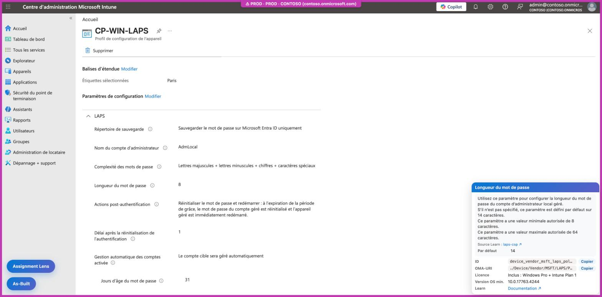

**Niveau 3** : l'explication rédigée passe en tête. La description Microsoft se replie, et la carte se termine par les valeurs possibles et les détails de Setting Inspector (ID, OMA-URI, licence, version OS, GPO et ADMX, documentation).

| Explication rédigée | Valeurs possibles et détails |
|---|---|
| 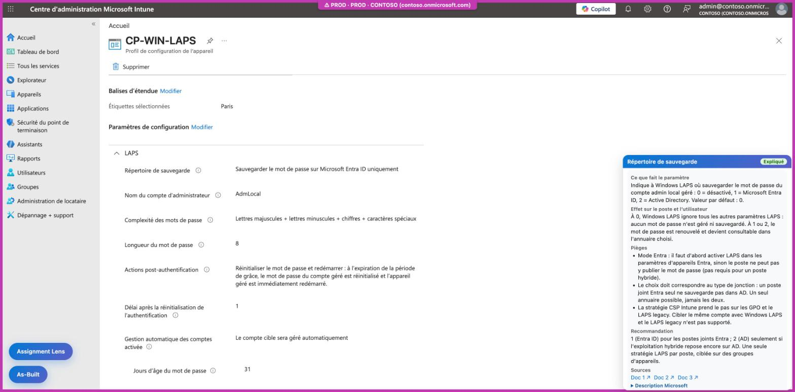 | 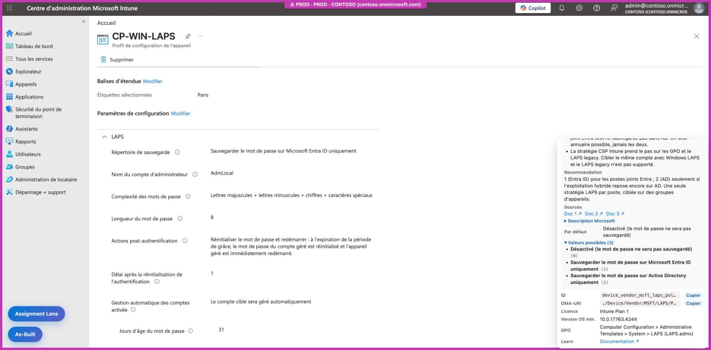 |

Explications livrées (12 paramètres, FR et EN, vérifiées sur Learn par une relecture indépendante) : Defender (analyse des archives, protection en temps réel, protection cloud), Windows Update (`AllowAutoUpdate`), télémétrie, Cortana, caméra, `DevicePasswordEnabled`, BitLocker `RequireDeviceEncryption`, LAPS (`BackupDirectory`, `PasswordAgeDays`), Windows Hello Entreprise (`UsePassportForWork`). Les variantes d'un même paramètre dans les modèles (par exemple `…_passwordagedays_aad`) reprennent l'explication du paramètre de base.

La page Learn est lue sans cookie, uniquement sur `learn.microsoft.com/…/windows/client-management/mdm/`, et gardée en cache 7 jours. Aucune donnée du tenant n'est envoyée.

Ajouter une explication : une entrée dans `explain.json`, sous l'ID du paramètre, avec `fr` et `en` (`what`, `impact`, `pitfalls`, `recommendation`, `sources`). `test.js` vérifie l'ID, les deux langues et les sources. Ne rédiger que pour les paramètres à pièges (interactions, contexte Intune, recommandation argumentée) : pour les autres, la page Learn suffit.

## OpenIntuneBaseline

Troisième section de la carte de paramètre (bascule en retrait sous Setting Inspector dans ⚙), activable seule. Si la baseline communautaire [OpenIntuneBaseline](https://openintunebaseline.com/) (OIB, SkipToTheEndpoint) configure le paramètre survolé, la carte affiche en tête la valeur retenue par OIB et le nom de la stratégie OIB qui la porte, avec un badge `OIB` dans le titre. Sinon : « Non configuré par OpenIntuneBaseline ». Le lien se fait par l'identifiant exact du paramètre (`settingDefinitionId`) : fonctionne quelle que soit la langue du portail, et une valeur à choix s'affiche avec le libellé du portail (en français si le portail l'est).

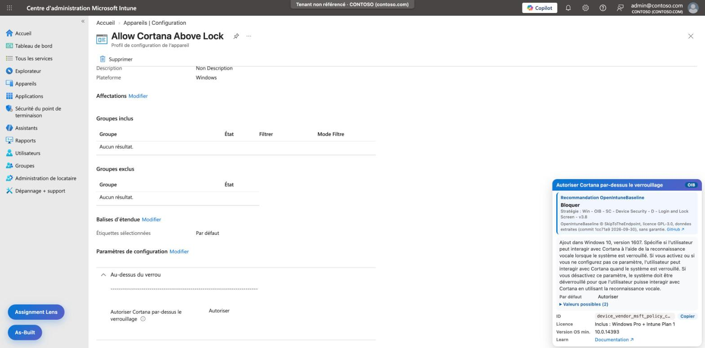

Quand le paramètre est reconnu par son nom (texte de la page, sans la liste de ses options), la valeur OIB est traduite avec les valeurs autorisées de la page Learn du CSP, en français quand elle existe : « Non autorisé (0) » plutôt que « 0 ».

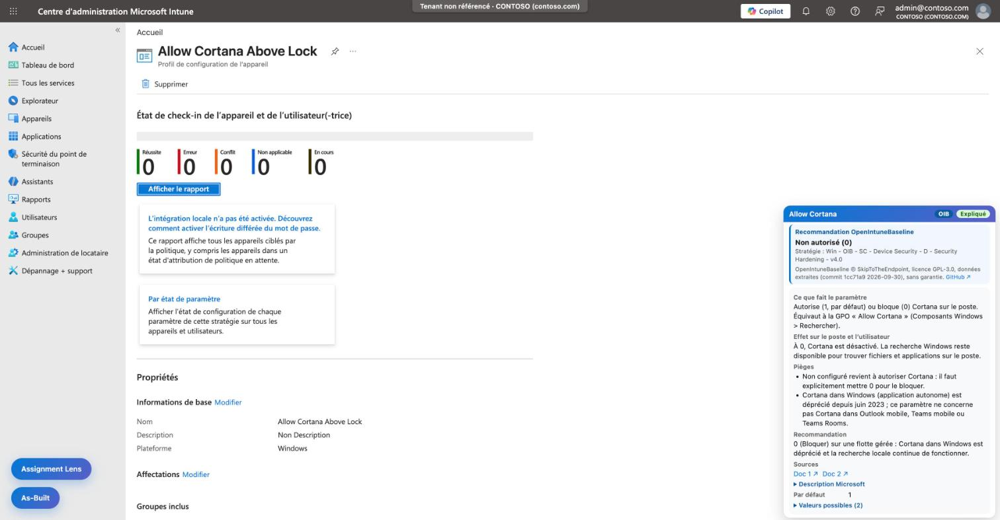

OIB est une baseline d'auteur (inspirée du CIS, du NCSC et d'autres référentiels), pas un standard de conformité : chaque organisation décide des paramètres qui lui conviennent, et les stratégies se testent avant déploiement.

Données : `setting-inspector/data/oib.json` (80 stratégies Settings Catalog Windows v4.0, macOS et Windows 365, 1 602 paramètres), produit depuis le dépôt OIB (Node 18+, sans dépendance) :

```sh
git clone --depth 1 https://github.com/SkipToTheEndpoint/OpenIntuneBaseline.git /tmp/oib
node setting-inspector/tools/build-oib.mjs /tmp/oib   # depuis tenant-compass/, écrase data/oib.json
```

Licence : OpenIntuneBaseline est sous **GPL-3.0**. `oib.json` est une version modifiée (extraction) distribuée sous la même licence ; le reste de Tenant Compass garde sa propre licence. Crédit, modifications, source et absence de garantie : `setting-inspector/data/OIB-NOTICE.md` ; texte de la licence : `setting-inspector/data/OIB-LICENSE.txt`. La carte rappelle l'auteur, la licence et le lien vers la source. Après une mise à jour, reporter le commit et la date dans `OIB-NOTICE.md`.

## Change Snapshot

Trace les modifications de stratégies faites dans le portail. À l'ouverture d'une stratégie, l'extension garde son état ; après un enregistrement réussi, une fenêtre en bas à droite montre la différence et demande un n° de ticket et un commentaire. L'entrée est enregistrée même sans ticket (marquée **sans ticket**). Le journal (📋 dans le menu) se filtre par stratégie, utilisateur et dates, et s'exporte en JSON et CSV (séparateur `;`).

Chaque entrée porte l'environnement détecté par Tenant Guard (**PROD** ou **non-prod**, `?` si l'onglet n'est pas classé). Dans ⚙ Paramètres, carte **Change Snapshot** :

- **Demander un ticket sur les tenants PROD** (activé par défaut) et **sur les tenants non-prod** (désactivé par défaut) : la modification est toujours journalisée, seule la fenêtre de ticket change. Onglet non classé : la fenêtre s'affiche.
- **Supprimer automatiquement les anciennes entrées** (activé par défaut) et **Durée de conservation (jours)** (14 par défaut, de 1 à 3650) : purge au réveil du service worker, donc à chaque visite du portail. Exportez le journal avant si vous devez le garder.

- Auteur et tenant lus dans le jeton du portail (décodage seulement) ; le jeton n'est jamais enregistré. Les valeurs secrètes sont masquées.
- Journal local au navigateur (`chrome.storage.local`, clés `e:<id>`) : utile pour la traçabilité, pas une preuve d'audit infalsifiable.
- Si la stratégie n'a pas été ouverte dans l'onglet avant la modification, la différence part de zéro (signalé).

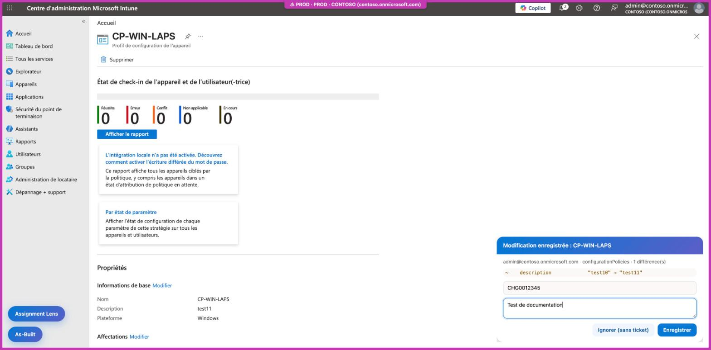

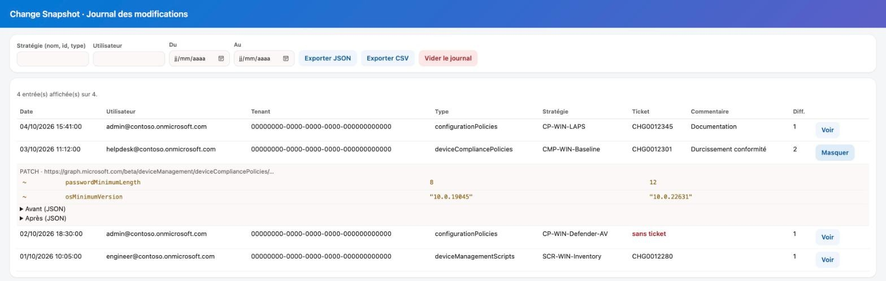

*Le journal est rendu avec le code réel de `journal.html` et des entrées fictives (Contoso) : la page de l'extension ne peut pas être capturée par l'outil d'automatisation.*

Le bouton **Enregistrer** de cette fenêtre n'écrit que dans le journal local : Tenant Guard ne demande pas de confirmation pour les boutons de Tenant Compass lui-même.

Détails (flux, points de terminaison couverts, limites) : [change-snapshot/README.md](change-snapshot/README.md).

## Set Tenant Language

Bascule la console entre **deux langues prédéfinies** (Langue 1, Langue 2), sans passer par *Paramètres > Langue + région*. Dans ⚙, choisir pour chacune la langue de la console (24 langues de la console Intune) et le format régional (dates, nombres) ; par défaut, Langue 1 = français, Langue 2 = anglais. Le menu affiche ensuite, empilés à gauche des fonctions actives, deux boutons **🌐 FR** et **🌐 EN** (selon les langues choisies) : un clic recharge l'onglet actif dans cette langue, sur la même page. Seule la langue de la **console** change, pas celle de l'extension.

| Console | Mécanisme | Testé le 2026-10-04 |
|---|---|---|
| Intune, Azure, Entra | `?l=<langue>.<format>` (ex. `?l=en.en-us`) | ✅ |
| Defender, Purview | `?mkt=<locale>` (ex. `?mkt=en-us`), langue seulement | ✅ |
| Centre d'administration Microsoft 365, Exchange, Teams, SharePoint | aucun paramètre d'URL ne change la langue : elle suit la langue du compte (*Mon compte > Paramètres et confidentialité*) | non pris en charge |

- Comportement observé des portails, non documenté sur Microsoft Learn : vérifier sur votre tenant si la langue reste appliquée après une navigation normale.
- Le rechargement perd les modifications non enregistrées de l'onglet.
- Code : `portal-language/lib.js` (testé : `node portal-language/test.js`).

## Raccourci PIM

Deux boutons violets du menu (la couleur de l'icône PIM du portail Azure, `#773adc`) ouvrent *Privileged Identity Management > Mes rôles > Rôles Microsoft Entra* dans un nouvel onglet :

- **🔑 PIM éligible** : onglet *Affectations éligibles*, pour activer un rôle.
- **🔑 PIM actif** : onglet *Affectations actives*, pour voir les rôles en cours, les désactiver ou les prolonger. Aucune adresse n'ouvre directement cet onglet : l'extension le sélectionne une fois la page chargée (2e onglet de la page, quelle que soit la langue du portail). Si Microsoft demande de se reconnecter, la page s'ouvre sur *Affectations éligibles*.

Si Tenant Guard a détecté le tenant de l'onglet actif (ID de tenant ou domaine `*.onmicrosoft.com`), PIM s'ouvre sur **ce** tenant (préfixe Azure `#@<tenant>/`), pas sur le tenant d'origine du compte : utile pour un prestataire qui travaille sur le tenant d'un client. Sinon, PIM s'ouvre sur le tenant par défaut du compte.

Une deuxième ligne ouvre les portails, sur le même tenant, chacun à la couleur de son icône :

- **🪪 Entra ID** : Microsoft Entra ID dans le portail Azure (`portal.azure.com`, préfixe `#@<tenant>/`), fond `#074793`.
- **💻 Intune** : centre d'administration Intune (`intune.microsoft.com`, préfixe `#@<tenant>`), fond `#5b5fc7`.
- **🛡️ Defender** : portail Microsoft Defender (`security.microsoft.com`), fond `#0078d4`. Le tenant n'est passé (`?tid=`) que si son ID est connu : un domaine n'y est pas accepté.

- Adresse : `https://portal.azure.com/#@<tenant>/view/Microsoft_Azure_PIMCommon/ActivationMenuBlade/~/aadmigratedroles`. Testé le 2026-10-04 (les deux boutons) ; comportement observé du portail, non documenté sur Microsoft Learn.
- Code : `pim/lib.js` (testé : `node pim/test.js`), sélection de l'onglet actif dans `background.js`.

## Policy Import

**Désactivée par défaut : c'est la seule fonction qui écrit dans le tenant.** Activez-la dans ⚙, puis rechargez l'onglet du portail.

Elle crée des stratégies Intune à partir des exports JSON d'As-Built, sans PowerShell, sans application à inscrire et sans Graph Explorer. Les appels passent bien par Microsoft Graph, avec la session du portail.

1. Cliquer sur **Import**, au-dessus du bouton Assignment Search, puis choisir un ou plusieurs fichiers `.json`.
2. Vérifier l'aperçu : chaque ligne indique le type, les avertissements et ce qui la bloque. Rien n'est écrit à cette étape.
3. Cliquer sur **Importer (n)**, vérifier l'annuaire et le tenant affichés, puis cliquer sur **OK**.

**Pris en charge** : catalogue de paramètres, profils de configuration (dont les profils personnalisés `.mobileconfig` et `.plist`), conformité, scripts PowerShell, scripts shell macOS, attributs personnalisés macOS, remédiations. Les autres types d'un export (applications, ADMX, inscription, rôles…) sont signalés et ignorés.

- **Préfixe** (optionnel) : ajouté au nom de chaque objet créé, avec le séparateur que vous tapez (`TEST - Ma stratégie`). L'aperçu montre le nom final, et les doublons sont vérifiés sur ce nom. Les noms de fichier des scripts et les noms de custom attribute ne changent pas.
- **Affectation** : sans option, une stratégie créée n'a d'effet sur aucun appareil. L'option **Affecter à** affecte chaque objet créé, en inclusion et sans filtre : à un groupe (recherche par nom, ou ID collé), à **Tous les utilisateurs** ou à **Tous les appareils**. Il s'applique alors aux utilisateurs ou appareils ciblés.
- **Scripts et remédiations** : les scripts ne sont affectés que si vous cochez **Affecter aussi les scripts**, car ils s'exécutent sur les appareils. Les remédiations ne sont jamais affectées : elles demandent un planning, à choisir dans le portail.
- **Scope tags** (option) : remplacent ceux du fichier, à la création.
- **Création seulement** : un `POST` par stratégie vers une liste fermée de collections, puis un `POST …/assign` si vous avez choisi une cible. Rien d'existant n'est modifié ni supprimé. Pour annuler, supprimez l'objet dans le portail : son ID s'affiche sur la ligne. Si l'affectation échoue, l'objet reste créé et la ligne l'indique.
- **Secrets** : une stratégie dont un secret est absent de l'export (valeur masquée ou chiffrée, clé Wi-Fi) est bloquée, à créer dans le portail.
- **Certificats** : un profil lié à un profil de certificat (SCEP, Wi-Fi Enterprise, VPN, réseau filaire…) est bloqué, car ce lien n'est pas dans l'export. Les liens facultatifs ne bloquent pas et sont perdus : certificat PKINIT de l'extension SSO, `privacyAccessControls` Windows.
- **Autre tenant** : les balises d'étendue reviennent à Default, et la conformité ne garde que l'action de blocage, avec son délai de grâce.
- **Doublons** : un nom déjà présent dans le tenant est décoché. Si les noms ne peuvent pas être lus, le type est bloqué.
- **Résultat inconnu** (erreur 5xx, coupure réseau) : l'objet existe peut-être, il n'y a donc pas de nouvel essai. Vérifiez dans le portail avant de relancer.
- **Droits** : le jeton du portail doit porter `DeviceManagementConfiguration.ReadWrite.All` (profils, catalogue, conformité) et `DeviceManagementScripts.ReadWrite.All` (scripts). Votre rôle Intune doit aussi être actif (PIM).
- **Journal** : Change Snapshot journalise chaque création, sans carte de ticket par objet.

> **N'importez que des fichiers de confiance.** Les scripts et profils d'un fichier sont copiés tels quels : un script peut s'exécuter sur les appareils dès que vous l'affectez. Les exports As-Built peuvent aussi contenir des jetons en clair dans un profil personnalisé (par exemple un jeton d'inscription d'agent).

Graph valide chaque objet à la création : un type de profil rare peut être refusé, et son message s'affiche alors sur la ligne.

- Code : `policy-import/lib.js` (testé : `node policy-import/test.js`), `policy-import/page.js`.

## Bulk Assignment

**Désactivée par défaut : elle modifie des stratégies existantes, qui s'appliquent ensuite aux appareils.** Activez-la dans ⚙, puis rechargez l'onglet du portail.

Comme As-Built, elle liste vos stratégies. Au lieu de les exporter, elle leur ajoute une affectation et des scope tags, en une seule fois.

1. Cliquer sur **Bulk Assign**, puis cocher les stratégies (recherche, filtres par type, par OS, par groupe affecté, par filtre d'affectation et par scope tag). Le survol d'une ligne affiche ses affectations et ses scope tags.
2. Choisir une cible : un groupe Entra ID (recherche par nom, ou ID collé), **Tous les utilisateurs** ou **Tous les appareils**. En option : un filtre d'affectation, en inclusion ou en exclusion, et des scope tags.
3. Cliquer sur **Appliquer (n)**, vérifier le tenant, la cible et le nombre de stratégies, puis cliquer sur **OK**.

**Pris en charge** : catalogue de paramètres, profils de configuration, conformité, modèles d'administration (ADMX), scripts PowerShell, scripts shell macOS, attributs personnalisés macOS, applications. Pas les remédiations (planning à choisir).

- **Filtres de la liste** : **Groupe affecté** montre les stratégies qui visent ce groupe, en inclusion ou en exclusion (ainsi que **Tous les utilisateurs** et **Tous les appareils**). **Filtre** montre celles dont une affectation utilise ce filtre d'affectation. **Scope tag** montre celles qui portent ce scope tag. Avec un groupe et un filtre, les deux doivent figurer sur la même affectation. Si Graph refuse la liste avec ses affectations pour un type, la liste simple est utilisée et la ligne d'état nomme ce type : ses stratégies n'apparaissent alors pas quand un groupe ou un filtre est choisi.
- **Survol** : chaque ligne affiche ses affectations (inclus, exclu, ou type de déploiement pour une application, avec le filtre éventuel) et ses scope tags, tels que lus avec la liste. Après **Appliquer**, la ligne montre ce qui vient d'être ajouté.
- **Ajout seulement** : Graph remplace toutes les affectations d'un objet à chaque envoi. L'extension relit donc les affectations existantes et les renvoie avec la nouvelle. Si cette lecture échoue ou est incomplète, rien n'est envoyé. Aucune affectation ni aucun scope tag n'est retiré.
- **Déjà en place** : si le groupe est déjà affecté ou exclu, ou si la même cible existe déjà, rien n'est envoyé, même avec un autre filtre. Un groupe exclu n'est jamais transformé en inclusion.
- **Applications** : dès qu'une application est cochée, choisissez son type de déploiement : **Requis**, **Disponible pour les appareils inscrits**, **Disponible avec ou sans inscription** (Android et iOS) ou **Désinstaller**. Il n'y a pas de valeur par défaut. Une application système Android Enterprise n'accepte que Requis ou Désinstaller. Les affectations existantes gardent leur type et leurs réglages, et un groupe ne prend qu'un seul type. Une application Managed Google Play reçoit la mise à jour automatique par défaut.
- **Groupe ou cible intégrée, pas les deux** : si un groupe est déjà affecté, **Tous les utilisateurs** et **Tous les appareils** sont refusés, et inversement. Rien n'est envoyé et la ligne l'indique. Un groupe exclu ne bloque pas : « tous les appareils sauf ce groupe » reste possible.
- **Ensembles de stratégies** : leurs affectations restent gérées par l'ensemble et ne sont pas renvoyées.
- **Filtres** : Microsoft ne les prend pas en charge sur les scripts PowerShell et shell, et l'extension traite les attributs personnalisés de la même façon. Une telle ligne est ignorée et le signale, plutôt que d'être affectée sans filtre, ce qui toucherait plus d'appareils que prévu.
- **Résultat inconnu** (erreur 5xx, coupure réseau) : vérifiez dans le portail avant de relancer. Une session expirée arrête la série : les lignes suivantes ne sont pas envoyées.
- **Droits** : mêmes droits d'écriture que Policy Import. Le rôle Intune doit être actif (PIM) et ses balises d'étendue doivent couvrir les stratégies.
- **Journal** : Change Snapshot journalise chaque modification, sans carte de ticket par objet.

> **Vérifiez la cible avant de cliquer sur OK.** Une affectation à **Tous les appareils** s'applique à tout le parc, un script affecté s'exécute sur les appareils, et une application en **Requis** ou **Désinstaller** s'installe ou se retire sans action de l'utilisateur. OK reste un seul clic, y compris sur un tenant PROD.

- Code : `bulk-assign/lib.js` et `shared/assign-lib.js` (testés : `node bulk-assign/test.js`), `bulk-assign/page.js`, `shared/graph-bridge.js`, `shared/assign-form.js`.

## Scope Tags Clean up

**Désactivée par défaut : elle modifie des stratégies et des applications existantes.** Activez-la dans ⚙, puis rechargez l'onglet du portail.

Comme As-Built, elle affiche une liste. La liste déroulante **Scope tag à retirer** donne le scope tag à traiter : Default au départ, ou n'importe quel autre scope tag du tenant, chacun suivi de son nombre d'objets. La liste montre chaque stratégie et application qui porte ce scope tag, avec tous ses scope tags. Les objets sur lesquels le bouton peut agir viennent en premier.

1. Cliquer sur **Scope Tags**, puis choisir le scope tag à retirer (Default par défaut).
2. Cocher les objets (recherche, filtres par type et par OS).
3. Cliquer sur **Retirer <scope tag> (n)**, vérifier le tenant et le nombre d'objets, puis cliquer sur **OK**.

**Exporter (JSON)** télécharge la liste des objets cochés, sans rien modifier : ID, nom, type, OS et scope tags (ID et nom) de chacun, tels qu'affichés dans la liste.

**Pris en charge** : catalogue de paramètres, profils de configuration, conformité, modèles d'administration (ADMX), scripts PowerShell, scripts shell macOS, attributs personnalisés macOS, remédiations, applications.

- **Sélection rapide** : la case **Seulement <scope tag> + un autre scope tag** ne garde que les objets à nettoyer. La case **Tout cocher** les prend alors tous d'un coup.
- **La règle**, la même pour chaque scope tag : le scope tag choisi n'est retiré que si un autre scope tag reste (Default compris). Un objet qui n'a que ce scope tag porte la balise **<scope tag> seul**. Vous pouvez le cocher, mais rien n'est envoyé pour lui, et sa ligne l'indique.
- **Relecture juste avant l'écriture** : c'est l'état réel de l'objet qui décide, pas la liste affichée. Si son autre scope tag a disparu entre-temps, rien n'est envoyé.
- **Seul le scope tag choisi est retiré** : les autres restent. Changer de scope tag décoche tout.
- **Effet** : les administrateurs limités au scope tag retiré ne verront plus ces objets. Le dialogue le rappelle avant OK.
- **Liste** : les objets sans le scope tag choisi n'y figurent pas. Ceux dont les scope tags sont illisibles sont comptés dans la ligne d'état, et un type que le jeton ne peut pas écrire y est nommé.
- **Résultat inconnu** (erreur 5xx, coupure réseau) : vérifiez dans le portail avant de relancer. Une session expirée arrête la série.
- **Droits** : `DeviceManagementConfiguration.ReadWrite.All` (profils, catalogue, conformité, ADMX), `DeviceManagementScripts.ReadWrite.All` (scripts, remédiations), `DeviceManagementApps.ReadWrite.All` (applications).
- **Journal** : Change Snapshot journalise les stratégies, sans carte de ticket par objet. Il ne suit pas encore les applications : leurs changements n'y apparaissent pas.

- Code : `scope-cleanup/lib.js` (testé : `node scope-cleanup/test.js`), `scope-cleanup/page.js`, `shared/graph-bridge.js`.

## Déplacement

As-Built, Assignment Lens, Assignment Search, Policy Import, Bulk Assignment et Scope Tags Clean up ne s'ouvrent pas en même temps : ouvrir l'un referme les autres, sauf ceux épinglés.

**Épingler** : le bouton 📌 de l'en-tête garde le panneau ouvert quand un autre module s'ouvre. Cliquer à nouveau dessus le désépingle, et **×** le ferme toujours. L'épingle dure jusqu'au rechargement de la page. Le panneau ouvert ou cliqué en dernier passe au-dessus des autres.

Les boutons et panneaux de ces six modules se déplacent à la souris (bouton : glisser ; panneau : glisser l'en-tête). Position mémorisée par élément dans le `localStorage` du portail (clés `tenant-compass:pos:*`), code commun dans `shared/drag.js`. Bouton **Positions par défaut** dans le menu : efface ces clés dans l'onglet actif et le recharge.

## Fonctionnement

`background.js` enregistre dynamiquement (`chrome.scripting.registerContentScripts`) les scripts des fonctions cochées, d'après `chrome.storage.sync` clé `features` (toutes actives par défaut, sauf Policy Import, Bulk Assignment et Scope Tags Clean up). Chaque fonction vit dans son dossier (`tenant-guard/`, `as-built/`, `setting-inspector/`, `settings-explainer/`, `assignment-lens/`, `assignment-search/`, `change-snapshot/`, `portal-language/`…), avec un `lib.js` testable sous Node et un `test.js`. Le style commun (dégradé #0078d4 → #5b5fc7) et le déplacement (`shared/drag.js`) sont partagés. Détails : [ARCHITECTURE.md](ARCHITECTURE.md).

## Limites

- Les tenants référencés dans l'extension Tenant Guard séparée ne sont pas repris : le stockage est propre à chaque extension, il faut les ressaisir.
- Assignment Lens ne fonctionne que sur `intune.microsoft.com` (pas `endpoint.microsoft.com`).
- Assignment Search n'évalue pas les filtres d'affectation et ne simule pas l'ajout ou le retrait d'un groupe. Il ne lit pas les anciens modèles de sécurité du point de terminaison (`intents`) ni Windows 365. Groupes et utilisateurs se cherchent par le début du nom, pas par un mot au milieu.
- OpenIntuneBaseline : la carte montre un instantané de la baseline (commit dans `setting-inspector/data/OIB-NOTICE.md`), à régénérer à chaque version OIB ; seules les stratégies Settings Catalog sont reprises (pas les stratégies de conformité ni de mise à jour).
- Dans une iframe du portail, la carte de paramètre s'ancre au bord droit de l'iframe, pas de la fenêtre.
- Le niveau 2 de Settings Explainer dépend de la structure des pages Learn ; si elle change, la carte garde les niveaux 1 et 3.
- La détection repose sur la structure actuelle du portail et des appels Graph. Les fonctions ont été vérifiées à la main dans un tenant de test (captures ci-dessus), pas par des tests automatisés dans le vrai portail.

## Tests

```
cd tenant-guard && node test.js
cd ../as-built && node test.js
cd ../setting-inspector && node test.js
cd ../settings-explainer && node test.js
cd ../assignment-lens && node test.js
cd ../assignment-search && node test.js
cd ../change-snapshot && node test.js
cd ../portal-language && node test.js
cd ../pim && node test.js
cd ../policy-import && node test.js
cd ../bulk-assign && node test.js
cd ../scope-cleanup && node test.js
cd ../shared && node test.js
```

## Licence

[PolyForm Noncommercial 1.0.0](LICENSE) : copie, modification et partage gratuits autorisés pour tout usage non commercial, à condition de conserver la ligne « Required Notice » (nom de l'auteur et source). Tout usage commercial demande un accord écrit.

Exception : `setting-inspector/data/oib.json`, extrait d'[OpenIntuneBaseline](https://github.com/SkipToTheEndpoint/OpenIntuneBaseline) (© SkipToTheEndpoint), est distribué sous [GPL-3.0](setting-inspector/data/OIB-LICENSE.txt) ; crédit, modifications et source : [`OIB-NOTICE.md`](setting-inspector/data/OIB-NOTICE.md).
<!--⁣​​‌​‌​​​​​​‌​​‌​‍​⁣ -->
